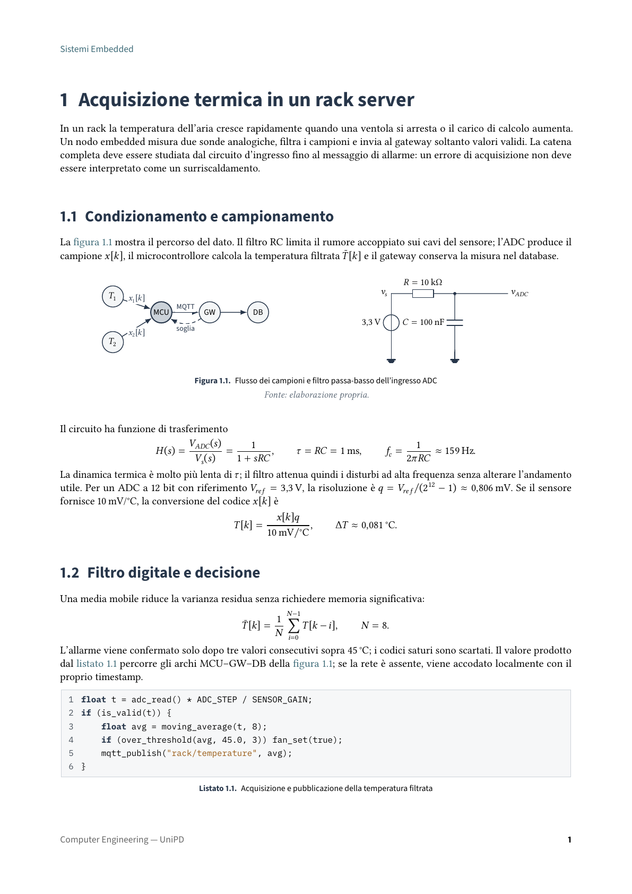

<p align="center">
  
</p>

<h1 align="center">UniPD Computer Engineering</h1>

<p align="center">
  <strong>Lecture notes, exercises, proofs, and diagrams for the 2026–2029 Computer Engineering cohort at the University of Padua.</strong>
</p>

<p align="center">
  <em>Unofficial and student-maintained. Not affiliated with or endorsed by the University of Padua.</em>
</p>

<p align="center">
  <a href="https://simonesiega.github.io/unipd-computer-engineering/">Notes website</a> ·
  <a href="#browse-the-notes">Browse notes</a> ·
  <a href="#coverage">Coverage</a>
</p>

<p align="center">
  <a href="https://github.com/simonesiega/unipd-computer-engineering/actions/workflows/ci.yml?query=branch%3Amain">
    
  </a>
  <a href="LICENSE">
    
  </a>
  <a href="LICENSE-MIT">
    
  </a>
</p>

<p align="center">
  <a href="https://www.unipd.it/"><strong>University of Padua</strong></a>
  &nbsp;·&nbsp;
  <a href="https://www.unipd.it/corsi-di-laurea/ingegneria-informatica"><strong>Computer Engineering degree programme</strong></a>
</p>

<details>
<summary><strong>Preview the notes</strong></summary>

<br />

<p align="center">
  
</p>

The preview shows an example of a note created with the custom LaTeX layout provided by the project.

</details>

## Overview

This archive collects notes for the 2026–2029 Computer Engineering cohort at the [University of Padua](https://www.unipd.it/). Courses are organized by degree year and use a shared LaTeX class.

Source files live here; compiled course PDFs are published through GitHub Releases where they can be downloaded or viewed on the [notes website](https://simonesiega.github.io/unipd-computer-engineering/). You do not need to clone or build the repository to read a published edition.

## Browse the notes

| Degree year | Academic year | Course directory |
|---|---|---|
| First year | 2026–2027 | [`1/`](1/) |
| Second year | 2027–2028 | [`2/`](2/) |
| Third year | 2028–2029 | [`3/`](3/) |

**[Download published compiled notes from GitHub Releases](https://github.com/simonesiega/unipd-computer-engineering/releases).**

Choose a snapshot for a fixed edition, or the rolling `notes-latest` release, when available, for the latest manually published build from `main`. Neither is updated on every source change. Course README download links point to `notes-latest` and may be unavailable before its first publication; the release table below links directly to published editions.

Pull-request PDFs are temporary GitHub Actions artifacts for review. If the material you need has not been published, build it locally.

Weekly generated changelogs under [`CHANGELOG/`](CHANGELOG/) record committed course-source changes and link them to the corresponding commits.

## Coverage

An exam is considered **covered** only when its intended notes are sufficiently complete, reviewed, and approved through an immutable snapshot release. The tables below are generated from published GitHub Releases and should not be edited manually.

<!-- RELEASE-CATALOG:START -->
| Degree year | Exams covered |
|---|---:|
| First year | 2 |
| Second year | 0 |
| Third year | 0 |
| **Total** | **2** |

Current covered exams:

| Year | Exam | Course archive | Compiled notes | Read online |
|---:|---|---|---|---|
| 1 | Analisi Matematica 1 | [`1/analisi-matematica-1`](1/analisi-matematica-1/) | [1-analisi-matematica-1.pdf](https://github.com/simonesiega/unipd-computer-engineering/releases/download/2026-2027-month-01/1-analisi-matematica-1.pdf) | [Read online](https://simonesiega.github.io/unipd-computer-engineering/analisi-matematica-1/index.html) |
| 1 | Fondamenti di Informatica | [`1/fondamenti-di-informatica`](1/fondamenti-di-informatica/) | [1-fondamenti-di-informatica.pdf](https://github.com/simonesiega/unipd-computer-engineering/releases/download/2026-2027-month-01/1-fondamenti-di-informatica.pdf) | [Read online](https://simonesiega.github.io/unipd-computer-engineering/fondamenti-di-informatica/index.html) |

## Releases

Browse the five most recent releases below, or [view all published releases](RELEASES.md).

| Release | Date | Title | PDFs |
|---|---|---|---|
| [`2026-2027-month-01`](https://github.com/simonesiega/unipd-computer-engineering/releases/tag/2026-2027-month-01) | 2026-10-24 | Month 1 Snapshot | [1-analisi-matematica-1.pdf](https://github.com/simonesiega/unipd-computer-engineering/releases/download/2026-2027-month-01/1-analisi-matematica-1.pdf)<br>[1-fondamenti-di-informatica.pdf](https://github.com/simonesiega/unipd-computer-engineering/releases/download/2026-2027-month-01/1-fondamenti-di-informatica.pdf) |
| [`2026-2027-week-02`](https://github.com/simonesiega/unipd-computer-engineering/releases/tag/2026-2027-week-02) | 2026-10-13 | Week 2 Snapshot | [1-analisi-matematica-1.pdf](https://github.com/simonesiega/unipd-computer-engineering/releases/download/2026-2027-week-02/1-analisi-matematica-1.pdf)<br>[1-fondamenti-di-informatica.pdf](https://github.com/simonesiega/unipd-computer-engineering/releases/download/2026-2027-week-02/1-fondamenti-di-informatica.pdf) |
| [`2026-2027-week-01`](https://github.com/simonesiega/unipd-computer-engineering/releases/tag/2026-2027-week-01) | 2026-10-07 | Week 1 Snapshot | [1-analisi-matematica-1.pdf](https://github.com/simonesiega/unipd-computer-engineering/releases/download/2026-2027-week-01/1-analisi-matematica-1.pdf)<br>[1-fondamenti-di-informatica.pdf](https://github.com/simonesiega/unipd-computer-engineering/releases/download/2026-2027-week-01/1-fondamenti-di-informatica.pdf) |
<!-- RELEASE-CATALOG:END -->

## Build locally

Clone the repository and build a course with the pinned TeX Live environment used by CI:

```bash
git clone https://github.com/simonesiega/unipd-computer-engineering.git
cd unipd-computer-engineering
docker compose run --rm texlive python3 latex/tools/build.py 1/analisi-matematica-1
```

With GNU Make installed, the same build is:

```bash
make build COURSE=1/analisi-matematica-1
```

Generated PDFs stay under `.build/<year>/<course>/main.pdf` and must not be committed.

See [Installation](docs/guides/getting-started/installation.md), [Docker builds](docs/guides/getting-started/docker.md), and [Building documents](docs/guides/getting-started/building-documents.md) for the complete setup and build workflow.

## Documentation

The [project-wide documentation router](docs/README.md) links contributor guides, LaTeX references, tools, tests, policies, and agent instructions. Start there to find the most specific guide for a task.

The [documentation site](https://simonesiega.github.io/unipd-computer-engineering/) adds search, navigation, course contents, and published-PDF readers after Pages is enabled. For local preview and deployment, use [Documentation site](docs/guides/development/documentation-site.md).

## Contributing

Contributions to the study material, LaTeX system, documentation, and repository tooling are welcome.

Before opening an issue or pull request, read [`CONTRIBUTING.md`](CONTRIBUTING.md) for the project workflow, quality standards, validation steps, licensing requirements, and academic-integrity rules. All participation must follow the [`CODE_OF_CONDUCT.md`](CODE_OF_CONDUCT.md).

AI-assisted work needs the same review as any other contribution. See [AI-assisted development](docs/guides/development/ai-assisted-development.md) for review and disclosure requirements.

Security vulnerabilities involving scripts, dependencies, automation, or configuration should be reported according to [`SECURITY.md`](SECURITY.md).

## Academic disclaimer

This is an independent and unofficial repository. It is not affiliated with, maintained by, or endorsed by the University of Padua.

The material is intended to complement lectures and official course resources, not replace them. Notes may contain errors, omissions, outdated information, personal interpretations, or inaccurate AI-assisted content, so important information should always be verified against official university resources, instructors, syllabi, textbooks, and teaching material.

The University of Padua name, logo, and related marks belong to their respective owners. Their use here is solely for identification and does not imply affiliation, authorization, or endorsement.

## License

| Material | License |
|---|---|
| Study notes and academic materials under `1/`, `2/`, and `3/` | [CC BY-SA 4.0](LICENSE) |
| Compiled note PDFs distributed through GitHub Releases | Generated distributions of their corresponding [CC BY-SA 4.0](LICENSE) sources |
| Shared LaTeX system, build and validation tools, release packaging, documentation except `CODE_OF_CONDUCT.md`, CI configuration, and other supporting project files | [MIT](LICENSE-MIT) |
| [`CODE_OF_CONDUCT.md`](CODE_OF_CONDUCT.md) | Adapted from the Contributor Covenant and distributed under [CC BY 4.0](https://creativecommons.org/licenses/by/4.0/) |
| Third-party fonts, assets, and bundled resources | Subject to their respective licenses. See [`latex/fonts/FONT-LICENSE.md`](latex/fonts/FONT-LICENSE.md) for font licensing information. |

## Contributors

<p align="center">
  <a href="https://github.com/simonesiega/unipd-computer-engineering/graphs/contributors">
    
  </a>
</p>
